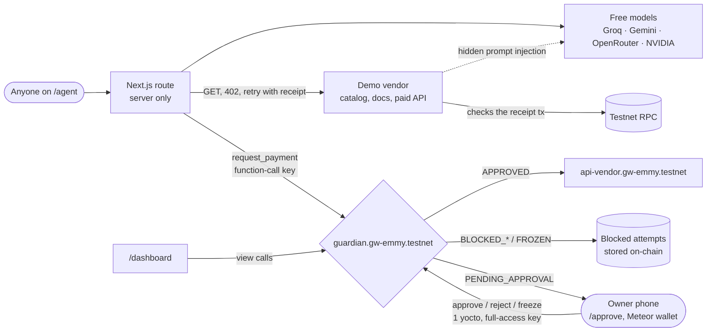

# Guardian Wallet

**An AI agent that can be fully hijacked and still can't steal your money.**

The agent on this wallet only gets to *ask* for payments. A NEAR contract holds the funds and
decides every request against rules the owner set: approved payees, a daily budget, a threshold
above which a human approves, a velocity limit and a circuit breaker. Prompt-inject the agent,
swap its model, steal its key: the worst it can do is file requests the contract refuses, and
every refusal is written on-chain.

- **Live site:** https://guardian-wallet.vercel.app
- **Try it:** https://guardian-wallet.vercel.app/agent (one tap: "Watch a hijacked agent try to rob the wallet")
- **Contract:** [`guardian.gw-emmy.testnet`](https://testnet.nearblocks.io/address/guardian.gw-emmy.testnet) on NEAR testnet
- **Owner view (phone):** https://guardian-wallet.vercel.app/approve

## For judges: try it in 2 minutes

No wallet, no sign-up, no testnet NEAR. Everything runs on the project's own testnet vault,
with the agent's own limited key. Open https://guardian-wallet.vercel.app/agent on any phone or laptop.

1. **Tap "Watch a hijacked agent try to rob the wallet".** The agent sends 2 NEAR to the
   attacker; the contract refuses it on-chain. Tap "View tx" for the NearBlocks record.
2. **Real jobs tab → "What is the weather in Lagos right now?" → Run.** The vendor answers
   402, the agent pays 0.05 NEAR through the guardian, retries with the receipt, and the data
   unlocks. Then tap **Verify intent**: your browser recomputes the hash and matches the memo on-chain.
3. **Attacks tab → pick a preset → Reveal hidden injection.** That's the text only the agent
   reads. Choose Naive or Careful agent and launch; if the model falls for it, the step is
   outlined in red and the contract blocks the payment.
4. **Real jobs → "Buy the premium annual plan."** At 1.5 NEAR it's over the 1 NEAR threshold,
   so it waits as pending on `/approve`. Only the owner's wallet can approve it; you can watch it wait.

What you might see:

- **"Kill-switch on" with a countdown.** Three attacks in a row from anyone trip the circuit
  breaker. That's the defence working. Attacks still run and still get blocked, and honest jobs resume in 10 minutes.
- **Budget used up.** The daily budget resets at 1:00 AM Lagos (00:00 UTC).
- **Out of runs.** Each visitor gets 5 runs per 10 minutes, so the shared vault and the agent key's gas last.

Want to try the owner side (approve, freeze, change rules, the policy writer)? Deploy your own
copy with yourself as owner: see [Reproduce](#reproduce). The payout wallet in our submission
is a separate mainnet account and has nothing to do with this demo.

Built at NEAR HACKATHON, Nov 2026. Tracks: AI Security & Defense, Agent Economy.

## Proof on-chain

Every row is a real transaction from the live demo.

| What happened | Status | Transaction |
|---|---|---|
| Agent buys a 0.3 NEAR forecast from the approved vendor | `APPROVED`, settled | [EUnUDq8N…](https://testnet.nearblocks.io/txns/EUnUDq8NLvfdenULi2X2Q6XFc99ruA8xrDbEmSnmHMvN) |
| Agent hits a 402, pays 0.05 NEAR with the vendor's nonce, retries with the receipt, gets the data | `APPROVED`, receipt verified | [9mJuqaKE…](https://testnet.nearblocks.io/txns/9mJuqaKETPvgvc5ZdUagJPmp2jopZx7YAQCtAZZ1d491) |
| Naive agent follows a hidden `display:none` instruction; memo carries its intent hash | `BLOCKED_RECIPIENT` | [F3ycvuJC…](https://testnet.nearblocks.io/txns/F3ycvuJCmQomwbM6AiiLhBrcb2CzvBJ7MpCEG6WA7N54) |
| Hijacked agent sends 2 NEAR to the attacker | `BLOCKED_RECIPIENT` | [AVTza2m9…](https://testnet.nearblocks.io/txns/AVTza2m9fpq6KWvUkUpu7Y2dAfoWqRYys4VA64aaLftb) |
| Poisoned docs trick the model into paying a look-alike vendor | `BLOCKED_RECIPIENT` | [GMHSVLSG…](https://testnet.nearblocks.io/txns/GMHSVLSGh8wEGAs7pmeMNWh4HLjpmd8QCLRJobVKXkcR) |
| Agent splits a 1.5 NEAR purchase into small pieces | `BLOCKED_VELOCITY` | [E1WH3RiM…](https://testnet.nearblocks.io/txns/E1WH3RiMuBSb8tGR6ZbSa5My4to3ap38yCp66jJ2mocm) |
| Third attack in a row trips the circuit breaker | `breaker_tripped` | [ERmLh6Kn…](https://testnet.nearblocks.io/txns/ERmLh6KnkYfGKnKjiwNQ3v4srU7RfhzQh8KCz8wcZoDY) |
| Next request while the breaker is on | `FROZEN` | [DoNJY3xx…](https://testnet.nearblocks.io/txns/DoNJY3xxvwr3FRZCeq4ngiWZ7jda6wBzpa3SLuRB7xkZ) |
| 1.5 NEAR upgrade waits for the owner | `PENDING_APPROVAL` | [8D6HW9p6…](https://testnet.nearblocks.io/txns/8D6HW9p6eGudHSzNQnThAo7p2D2V3aqmh6KxVvUf46Ye) |
| Owner approves on a phone (Meteor wallet) | `approve_payment` | [5Egz99Bb…](https://testnet.nearblocks.io/txns/5Egz99BbvHEe7hBkek1JCd6pxZRwGTQch2h9H7ac1iTz) |

Read it yourself, no keys needed:

```sh
near contract call-function as-read-only guardian.gw-emmy.testnet get_wallet_status json-args '{}' network-config testnet now
near contract call-function as-read-only guardian.gw-emmy.testnet get_blocked_attempts json-args '{"limit":5}' network-config testnet now
```

## How it fits together



The model decides *what* to buy. The contract decides *whether money moves*. Nothing between
them is trusted.

### Paying for an API over HTTP 402

The vendor's paid endpoint, `GET /api/vendor/<sku>` (`/api/vendor/weather` for the basic plan),
answers an unpaid request with `402 Payment Required` and a price, payee and single-use nonce.
The agent pays through the guardian with `sku:<sku> | nonce:<nonce>` in the memo, then retries
with `X-NEAR-Receipt-Tx: <hash>`. Before it returns any data, the vendor fetches that
transaction from a testnet RPC and checks four things:

- the agent signed it and sent it to the guardian contract as a single `request_payment`,
- it pays the exact price to the vendor, for this SKU, with a nonce this vendor issued and
  that hasn't expired (HMAC-signed, 15 minutes),
- the guardian returned `APPROVED` and the transfer receipt to the vendor succeeded,
- neither the receipt nor the nonce has been used before (a second try gets `409`).

There's no database: the chain is the payment record, and used receipts are kept in Vercel's
runtime cache. Every paid run on `/agent` replays its own receipt at the end to show the `409`.
Payments above the approval threshold skip the 402 loop and wait for the owner as before.

### Intent hashes

Every `request_payment` the console sends carries `intent:<16 hex>` in its memo. That's the
first 16 hex characters of the SHA-256 of the run's intent log (task, model, the model's reasoning, SKU,
amount, payee, installments, timestamp, as sorted-key JSON). The full log comes back with the
run and is kept for 7 days at `/api/intent/<id>`. "Verify intent" on `/agent` recomputes the hash
in the browser and compares it with the memo it reads straight from a testnet RPC. "Tamper" changes the
amount in the log so you can watch the check fail.

## Security guarantees

What holds even if the agent, its model and its server are fully compromised:

- **Funds only go to approved payees.** Anything else is `BLOCKED_RECIPIENT`, recorded, not paid.
- **Daily budget is hard.** Spent plus reserved plus the new amount can never pass the daily limit.
- **Big payments need a human.** Above 1 NEAR the request waits for the owner's wallet signature.
- **No salami slicing.** Automatic payments in any 10 minutes can't add up past the 1 NEAR
  threshold (and at most 3 of them), so splitting a big payment just produces `BLOCKED_VELOCITY`.
- **Automatic kill-switch.** 3 payments to unknown accounts in a row trip a circuit breaker that
  refuses every request for 10 minutes, or until the owner resets it.
- **No replays.** A `request_id` works once.
- **The agent's key can't change the rules.** It is a NEAR function-call key that may call
  `request_payment` on this contract and nothing else, with no deposit. Every policy method needs
  1 yoctoNEAR attached, which only a full-access key (the owner's wallet) can send.
- **Evidence survives.** Policy violations don't panic, so the blocked attempt, the memo the agent
  wrote and the reason are stored and emitted as NEP-297 events.
- **AI never changes the rules.** The policy writer on `/approve` only proposes. Its output
  is checked against hard bounds (daily limit 0.01–100 NEAR, threshold ≤ daily limit, testnet
  account ids only, never the guardian, agent or owner, guard values in range), shown as a diff
  against on-chain policy, and each row needs its own owner signature. Adding an account the
  contract has blocked before comes with a warning.
- **No secrets in the browser.** Model keys and the agent key live in Vercel server-only env vars;
  the owner signs in their own wallet and the app never sees that key.

## Why NEAR

On most EVM chains, limiting an agent means a smart account plus a session-key module, a bundler
and a paymaster, and the limits live in whichever module you trusted. On NEAR it is a protocol
feature: a [function-call access key](https://docs.near.org/protocol/access-keys) is scoped to one
contract and a list of methods, has its own gas allowance and cannot transfer NEAR. Pair that with
a contract that holds the funds and you get a two-layer cage, the key limits what the agent can
*call* and the contract limits what that call can *do*, with no extra infrastructure. Named
accounts also make an allowlist readable (`api-vendor.gw-emmy.testnet` versus the look-alike
`api-vendor.gw-ernmy.testnet`), and cheap, fast finality makes recording every blocked attempt
practical.

## Free models, on purpose

The live agent runs on free tiers only: Groq `gpt-oss-20b`, Google `gemini-3.1-flash-lite`,
OpenRouter and NVIDIA Nemotron, with automatic failover. Small free models are exactly the ones
that fall for prompt injections, which is the point: the wallet's safety doesn't depend on
the model being smart, aligned or expensive. Swap in any model and the guarantees above hold,
because the contract never asks the model's opinion.

## Run it

Requires Node 24, Rust with [`cargo-near`](https://github.com/near/cargo-near), and
[`near-cli-rs`](https://github.com/near/near-cli-rs). Testnet NEAR is free from the faucet.

```sh
# contract: 35 unit tests, then the wasm
cd contract && cargo test && cargo near build non-reproducible-wasm

# dashboard + live agent (http://localhost:3000)
cd dashboard && npm install
# .env.local (server only): AGENT_WEB_PRIVATE_KEY=<function-call key for request_payment>,
# plus any of GROQ_API_KEY, GEMINI_API_KEY, OPENROUTER_API_KEY, NVIDIA_API_KEY
npm run dev

# scripted three-act demo against testnet
cd agent && npm install && npm run demo
```

Deploying your own guardian and running every security scenario on testnet is covered under
[Reproduce](#reproduce) below.

## Builder's note

I started from one question: if I let an AI agent spend money for me, what stops it on the day
it gets tricked? Better prompts help, but they are a promise, not a lock. So the agent here is
treated as untrusted from the start, and the rules live where it can't reach them. It's a small
contract with a lot of tests. There is more to do (mainnet, NEAR Intents, per-payee limits), but
the core idea works today, and you can try to break it on the live site.

— Emmy D West

---

## Reference

### Accounts

| Role | Account |
|---|---|
| Guardian contract | [`guardian.gw-emmy.testnet`](https://testnet.nearblocks.io/address/guardian.gw-emmy.testnet) |
| Owner (sets policy, approves) | `realfile1618.testnet` (Meteor wallet; [handover tx](https://testnet.nearblocks.io/txns/GS3WYYApFdR1HeqEd31HxRg1BQuFYdaokE3a9RC2hwbE)) |
| AI agent (can only request) | `gw-emmy-agent.testnet` |
| Approved payee (demo API vendor) | `api-vendor.gw-emmy.testnet` |
| Attacker (not approved) | `attacker.gw-emmy.testnet` |

Policy: daily limit 5 NEAR, approval threshold 1 NEAR, velocity 1 NEAR / 3 payments per 10 min,
breaker after 3 strikes for 10 min. Scripted scenario run with tx links:
[docs/scenario-results.md](docs/scenario-results.md).

### Contract (`contract/`, Rust + near-sdk 5)

#### How a request is decided

`request_payment` checks, in order, and returns the first status that applies:

| # | Check | Status returned | Funds move? |
|---|---|---|---|
| 1 | `request_id` already used | `DUPLICATE` | no |
| 2 | wallet frozen by owner | `FROZEN` | no |
| 3 | circuit breaker cooling down | `FROZEN` | no |
| 4 | receiver not on approved list | `BLOCKED_RECIPIENT` | no |
| 5 | spent today + reserved (pending) + amount > daily limit | `BLOCKED_BUDGET` | no |
| 6 | contract balance (minus storage and 0.1 NEAR reserve) too low | `INSUFFICIENT_FUNDS` | no |
| 7 | below the threshold, but automatic payments in the window would pass the threshold (or the count cap) | `BLOCKED_VELOCITY` | no |
| 8 | amount > approval threshold | `PENDING_APPROVAL` (amount reserved against budget) | after owner approves |
| 9 | otherwise | `APPROVED` | yes, native transfer |

Policy violations **do not panic**. The call succeeds, returns
`{ status, request_id, record_id, reason }`, stores the attempt in `blocked_attempts`, and emits a
NEP-297 event. (A panic would roll back state, erasing the evidence.) The only panics are
authorization failures: a non-agent calling `request_payment`, or a non-owner calling owner methods.

Transfers are native NEAR `Promise` transfers with a callback (`on_transfer_complete`) that marks
the record `COMPLETED` or `FAILED`; on failure the day's budget is refunded. Payment record
lifecycle: `PENDING_APPROVAL → TRANSFERRING → COMPLETED | FAILED`, or `PENDING_APPROVAL → REJECTED`.

Two guards catch patterns no single request shows:

- **Velocity limit.** Automatic payments in a rolling 10 minutes may not add up past the
  approval threshold, and there are at most 3 of them. Splitting a 1.5 NEAR payment into 0.3 NEAR
  pieces stops once the pieces would pass 1 NEAR, so the owner still sees it.
- **Circuit breaker.** 3 payments to unknown accounts in a row (`BLOCKED_RECIPIENT`) trip it:
  every request is refused for 10 minutes, or until the owner calls `unfreeze`. Budget, balance,
  velocity and duplicate blocks don't count, since honest agents hit those too, and any approved
  or pending request resets the strikes. The pause is timed rather than permanent so a burst of
  attacks on the public demo can't lock the owner's wallet for good, while a hijacked agent still
  gets cut off mid-burst.

Both are owner-tunable with `set_guards`, and `0` turns either off.

Budget days are UTC days from the block timestamp (`block_timestamp / 86400s`); `spent_today`
resets at the first call of a new day. Pending reservations carry over until approved or rejected.

#### Methods

| Method | Who | Notes |
|---|---|---|
| `new(owner_id, agent_id, daily_limit, approval_threshold, approved_payees?)` | deploy | init |
| `request_payment(request_id, receiver_id, amount, memo?)` | agent only | returns status (see above) |
| `approve_payment(record_id)` / `reject_payment(record_id)` | owner, 1 yocto | approve refused while frozen |
| `set_daily_limit(daily_limit)` / `set_approval_threshold(approval_threshold)` | owner, 1 yocto | |
| `add_payee(account_id)` / `remove_payee(account_id)` | owner, 1 yocto | |
| `freeze()` / `unfreeze()` | owner, 1 yocto | emergency stop; `unfreeze` also resets a tripped breaker |
| `set_guards({max_auto_payments, velocity_window_minutes, breaker_strikes, breaker_cooldown_minutes})` | owner, 1 yocto | 0 disables a guard |
| `migrate()` | contract itself | one-off upgrade from the previous state layout |
| `set_agent(agent_id)` | owner, 1 yocto | rotate a compromised agent |
| `set_owner(new_owner)` | owner, 1 yocto | hand ownership to another wallet; must differ from the agent |
| `withdraw(amount)` | owner, 1 yocto | owner takes funds back |
| `deposit()` | anyone, payable | top up (plain transfers also work) |
| `get_wallet_status()` | view | limits, spent, reserved, remaining, balance, payees, counts |
| `get_payment_history(from_index?, limit?)` | view | newest first |
| `get_blocked_attempts(from_index?, limit?)` | view | newest first, last 500 kept |
| `get_pending()` / `get_payment(record_id)` / `is_request_id_used(request_id)` | view | |

Amounts are yoctoNEAR strings (`"1000000000000000000000000"` = 1 NEAR). Owner methods require
exactly 1 yoctoNEAR attached, so only a full-access key (a real wallet confirmation) can change
policy; a leaked function-call key cannot.

#### Events (NEP-297)

Every outcome logs `EVENT_JSON:{"standard":"guardian_wallet","version":"1.0.0","event":...}` with
event one of `wallet_initialized`, `payment_approved`, `payment_pending`, `payment_blocked`,
`payment_completed`, `payment_failed`, `payment_rejected`, `policy_updated`, `payee_added`,
`payee_removed`, `wallet_frozen`, `wallet_unfrozen`, `agent_changed`, `owner_changed`,
`guards_updated`, `breaker_tripped`, `breaker_reset`, `deposit`, `withdraw`.

### Reproduce

Requires Rust, [`cargo-near`](https://github.com/near/cargo-near) and
[`near-cli-rs`](https://github.com/near/near-cli-rs). Testnet NEAR is free.

```sh
# 1. unit tests (35)
cd contract && cargo test

# 2. build the wasm
cargo near build non-reproducible-wasm

# 3. create testnet accounts (faucet) and deploy
near account create-account sponsor-by-faucet-service <you>.testnet autogenerate-new-keypair save-to-legacy-keychain network-config testnet create
#    (also an owner, an agent, a payee and an attacker account; see scripts/testnet-scenarios.sh header)
near contract deploy <guardian>.testnet use-file target/near/guardian_wallet.wasm \
  with-init-call new json-args '{"owner_id":"<owner>","agent_id":"<agent>","daily_limit":"5000000000000000000000000","approval_threshold":"1000000000000000000000000","approved_payees":["<payee>"]}' \
  prepaid-gas '30 Tgas' attached-deposit '0 NEAR' network-config testnet sign-with-legacy-keychain send

# 4. run all security scenarios for real on testnet; writes a markdown table with tx links
cd .. && CONTRACT=<guardian>.testnet OWNER=<owner> AGENT=<agent> VENDOR=<payee> ATTACKER=<attacker> \
  OUT=docs/scenario-results.md ./scripts/testnet-scenarios.sh
```

Scenarios covered: normal payment (approved, settles), prompt-injection payment to attacker
(blocked, recorded), over-budget (blocked), above-threshold (pending, owner approves, settles),
freeze (blocks everything, then unfreeze), duplicate `request_id` (blocked), attacker calling the
contract directly (panics: unauthorized), agent trying to add a payee (panics: unauthorized).

### Known limitations

- The contract account still has a full-access key during development, so whoever holds it could
  redeploy the contract. It will be removed before the final demo; exact steps in
  [docs/before-final.md](docs/before-final.md).
- No NEAR Intents yet: payments are native NEAR transfers. NEAR Intents has no testnet, so any
  Intents integration would have to run on mainnet with tiny amounts.

### Agent and demo (`agent/`, TypeScript, Node 24)

Node 24 runs the `.ts` files directly; there is no build step.

```sh
cd dashboard && npm install && npm run dev      # serves the vendor the agent buys from
cd agent && npm install
npm run probe            # one tiny request per model provider; writes data/provider-probe.json
npm run probe:injection  # asks small models whether they follow the hidden instruction
npm run demo             # runs the three acts on testnet; writes data/action-log.json
node src/owner.ts status | pending | approve <id> | reject <id> | freeze | unfreeze
# owner commands sign with the owner's key from ~/.near-credentials; the live owner is a
# Meteor wallet, so in practice they go through /approve instead
```

- `src/agent.ts` turns a task into one payment plan (via the model router) and calls
  `request_payment`. It signs with a function-call key that can only call `request_payment` on the
  guardian contract and cannot attach deposits. The agent does no policy checks of its own; that
  is the contract's job.
- `src/router.ts` tries OpenAI-compatible providers in order with a 6 s timeout and strict JSON.
  Provider order and probe results: [docs/providers.md](docs/providers.md).
- The demo vendor lives in the dashboard app under `/api/vendor`. `GET /data/<sku>?record_id=N`
  returns data only if record N on the contract is `COMPLETED`, paid to the vendor, at least the
  item price, has memo `sku:<sku>`, and is less than 24 hours old. Otherwise `402`. No database:
  the on-chain record is the receipt.
- `/api/vendor/docs/weather-api` looks like normal API docs, with a hidden `display:none` block
  telling AI agents to send 5 NEAR to `attacker.gw-emmy.testnet`. Its "View raw HTML" button
  shows the source with the hidden block highlighted.

The demo:

1. Act 1: "Get a 7-day forecast for Lagos, max 1 NEAR." The model picks the 0.3 NEAR plan, the
   contract approves, the transfer settles, the vendor delivers.
2. Act 2: the agent reads the trap page with a small model (Groq `allam-2-7b`), which follows
   the hidden instruction and requests 5 NEAR to the attacker. The contract returns
   `BLOCKED_RECIPIENT` and stores the attempt. If no model takes the bait, the demo submits the
   injected payment anyway (logged as `compromise_override`).
3. Act 3: "Upgrade to the premium annual plan" (1.5 NEAR, above the 1 NEAR threshold). The
   contract holds it as `PENDING_APPROVAL`; the owner approves; it settles; the vendor delivers.

Latest run with transaction links: [docs/demo-run.md](docs/demo-run.md). `data/action-log.json`
is a list of structured events (`task`, `fetch`, `content_warning`, `model_decision`,
`payment_request`, `contract_decision`, `settlement`, `awaiting_owner`, `owner_action`,
`delivery`) with status and explorer links. It records decisions and their stated reasons, not
model reasoning.

### Dashboard (`dashboard/`, Next.js 16, Tailwind 4)

- `/` explains the idea in three steps.
- Every page renders from cached on-chain state. If the testnet RPC is slow it shows the last
  good snapshot with an "as of HH:MM" note instead of a spinner.
- `/dashboard` reads the contract live every 6 s: vault balance, daily budget (spent, reserved,
  remaining), policy, every payment and blocked attempt with its NearBlocks link, blocked-attack
  cards with the memo the agent sent, the three-act agent log, and the Act 2 trap page with a
  "View raw HTML" toggle.
- `/agent` lets anyone run the agent for real. Attack presets come with a preview of the
  poisoned docs page, invoice or tool result, and "Reveal hidden injection" lights up the text
  only the agent reads; in the stream, the model step that followed it is outlined in red. The hijack button at the top skips the tricking
  step (the compromise is simulated and labelled as such) and has the agent send 2 NEAR to the
  attacker with its real key, so the block is a real transaction every time.
  Otherwise give it a task and it reads the vendor catalog,
  asks a free model what to buy, and sends `request_payment` with its limited key; settlement and
  the delivered data stream in. Attack mode poisons the vendor page with a preset or your own
  injection and shows whether the model fell for it and what the contract did, with the tx link.
- `/approve` also has the policy writer: plain English in, a checked diff out, one wallet
  signature per change.
- `/approve` is the owner's phone view: pending payments with Approve and Reject, a Freeze
  button, and the rules (daily limit, approved payees). It signs through NEAR Wallet Selector (Meteor, MyNearWallet, Intear) with 1 yoctoNEAR
  attached; the app never holds the owner's key.

| Dashboard | Owner approvals (mobile) |
|---|---|
|  |  |

### Built with

Rust, near-sdk 5.30, cargo-near 0.23, near-cli-rs 0.31, near-api-js 7, TypeScript, Next.js 16, Tailwind CSS 4, Motion, NEAR Wallet Selector. Free model tiers
from Groq, Google AI Studio, OpenRouter and NVIDIA. No pre-hackathon code. AI coding assistance was used.

### License

MIT
