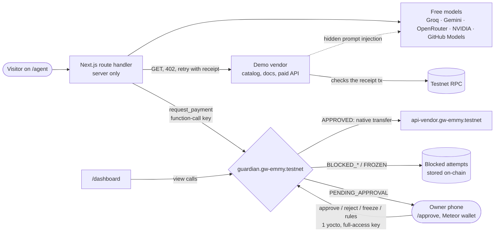

# Guardian Wallet: full project overview for review

This document describes Guardian Wallet for someone with no prior context and no access to the
code. It covers what the project is, how it works, what it proves, what is weak about it, and
the questions we want a reviewer to answer. Everything here reflects the live state on
11 Nov 2026.

- Live site: https://guardian-wallet.vercel.app
- Live agent console: https://guardian-wallet.vercel.app/agent
- Live dashboard: https://guardian-wallet.vercel.app/dashboard
- Owner view: https://guardian-wallet.vercel.app/approve
- Create your own wallet: https://guardian-wallet.vercel.app/start · assistant: https://guardian-wallet.vercel.app/chat
- Factory: `factory.gw-emmy.testnet`, https://testnet.nearblocks.io/address/factory.gw-emmy.testnet
- Contract: `guardian.gw-emmy.testnet` on NEAR testnet,
  https://testnet.nearblocks.io/address/guardian.gw-emmy.testnet
- Builder: Emmy D West (solo)

---

## 1. Hackathon context

- **Event:** NEAR Hackathon (Nov 2026).
- **Deadline:** 14 Nov 2026, 23:59 UTC (00:59 on 15 Nov in Lagos, where the builder is).
- **Tracks entered:** AI Security & Defense, and Agent Economy.
- **Judging:** an AI screening pass first, then human judges. Criteria: technical implementation,
  design, impact, originality and sustainability.
- **Submission:** a public GitHub repo plus a demo post on X (a video of under 3 minutes is
  planned). The repo is private until submission.

Judges are expected to spend most of their attention on the video and maybe a couple of minutes on
the live site, so the project is built so that its main claim can be checked in one tap.

---

## 2. The problem and the thesis

### In plain English

AI agents are starting to spend money for people: paying for APIs, data, compute, small
purchases. To do that, the agent normally holds a key that can move funds. But an agent reads
everything it touches: web pages, invoices, tool results. Any of those can contain hidden text
that tells it to do something else ("prompt injection"). If the agent holds the money, one
poisoned page can send that money to an attacker.

Most current fixes try to make the model harder to fool: better prompts, filters, a second model
checking the first. Those help, but they are promises, not locks. A clever enough injection, or a
weaker model, still gets through.

**Guardian Wallet's thesis:** assume the agent *will* be hijacked, and make that not matter.

The agent never holds the money. It can only *ask* a smart contract to pay someone. The
contract holds the funds and checks every request against rules the owner set. If the request
breaks a rule, the contract refuses it and writes the refusal on-chain as evidence. The
worst a fully compromised agent can do is file requests that get refused.

One-line pitch: **"An AI agent that can be fully hijacked and still can't steal your money."**

### In technical terms

- The agent holds a NEAR **function-call access key**. NEAR's protocol scopes this key to one
  contract (`guardian.gw-emmy.testnet`) and one method (`request_payment`). It has its own gas
  allowance and cannot attach a deposit, so it cannot transfer NEAR or call anything else.
- The **guardian contract** (Rust, near-sdk 5.30) holds the vault. `request_payment` evaluates
  allowlist, budget, balance, velocity, approval threshold, freeze, circuit breaker and replay
  rules, then either transfers natively, holds for the owner, or records a block.
- Policy changes need **1 yoctoNEAR attached**, which only a full-access key (the owner's
  wallet) can provide, so even a stolen agent key cannot touch the rules.
- Blocks **do not panic**. The call succeeds and stores the attempt, so the evidence isn't rolled
  back.

---

## 3. Architecture

### Accounts (all NEAR testnet)

| Role | Account |
|---|---|
| Guardian contract (holds the vault) | `guardian.gw-emmy.testnet` |
| Owner (sets rules, approves) | `realfile1618.testnet` (a Meteor wallet) |
| AI agent (can only request) | `gw-emmy-agent.testnet` |
| Approved payee (demo API vendor) | `api-vendor.gw-emmy.testnet` |
| Attacker (not approved) | `attacker.gw-emmy.testnet` |
| Look-alike used in one attack | `api-vendor.gw-ernmy.testnet` ("rn" instead of "m") |
| Factory (one guarded wallet per user) | `factory.gw-emmy.testnet`, admin `realfile1618.testnet` |
| Example user wallet and its agent | `boxtest.factory.gw-emmy.testnet`, `boxtest-agent.factory.gw-emmy.testnet` (owner `gw-emmy-fund1.testnet`) |

The live policy: daily limit 5 NEAR, owner approval above 1 NEAR, velocity of at most 3
automatic payments and 1 NEAR in any 10 minutes, circuit breaker after 3 strikes for 10 minutes.
The vault holds about 17 testnet NEAR. As of writing the contract has recorded 29 payments and
58 blocked attempts.

### Components

1. **Contract** (`contract/`, Rust). The only thing that can move funds. 42 unit tests.
   Upgraded three times on testnet with state migrations.
2. **Agent key.** A function-call key on `gw-emmy-agent.testnet`, limited to `request_payment` on
   the guardian, with a gas allowance (about 3 NEAR). It lives only in a Vercel server-only env
   var, never in the browser.
3. **Agent runtime** (server route `/api/agent/run`, streams NDJSON). It reads the vendor catalog
   and docs, asks a model for a JSON payment plan, sends `request_payment` through the SDK, and
   streams every step to the browser.
3b. **SDK** (`packages/sdk`, `guardian-wallet-sdk`). A dependency-free TypeScript package with a
   `GuardianAgent` class: `requestPayment`, `getPolicy`, `getStatus`, `getPayment`,
   `waitForSettlement` and `pay402(url)` (fetch, pay the 402 challenge, retry with the receipt).
   Results use the contract's status enum. Signing is injected (`accountSigner(account)` wraps a
   near-api-js Account), so a key can live in a KMS or TEE. The live console runs on it.
   A local stdio MCP server (`packages/mcp-server`) wraps the same SDK with four tools:
   `guardian_wallet_status`, `guardian_get_payment`, `guardian_request_payment`,
   `guardian_fetch_402`. It is not published to npm.
4. **Model router.** Only free tiers. It tries providers in order with an 8 s timeout each,
   strict JSON mode, and moves to the next provider on an error or an empty reply.
   - Main chain: Groq `openai/gpt-oss-20b` → Google `gemini-3.1-flash-lite` → OpenRouter
     `nvidia/nemotron-3.5-lightning:free` → NVIDIA `nemotron-3.5-lightning-30b-a3b` → GitHub Models `openai/gpt-4o-mini` (skipped if the endpoint does not return a completion).
   - "Naive" chain for attack demos: Gemini, Groq `allam-2-7b`, small OpenRouter Liquid models,
     then the main chain.
   - If every model fails on a real job, a rule-based planner picks the matching catalog item.
     In attack mode nothing is sent.
5. **Demo vendor** (inside the same Next.js app, under `/api/vendor`). A fake "SkyCast" shop
   with a catalog (weather, news, translation, icons, a market report, an annual plan), a docs
   page (with a hidden injection for the trap), and a paid endpoint that uses HTTP 402.
6. **Dashboard app** (Next.js 16 with cache components, Tailwind 4, NEAR Wallet Selector),
   deployed on Vercel. Pages: `/`, `/start`, `/wallet`, `/vault/<id>`, `/vault/<id>/request/<n>`,
   `/chat` (Live Agent), `/agent` (Attack Demo), `/dashboard`, `/approve`, `/docs`, `/verify`.
6b. **Factory** (`factory/`, Rust, 15 unit tests). `create_vault` makes `<name>.factory.gw-emmy.testnet`
   with the caller as owner and a template's rules, running the guardian code published once as a
   NEP-591 global contract (code hash `3Rh6iyiZbmi3gQjsWZMGyB7YmNovekeegaQaHBiskmaA`, about 23 NEAR
   burned once from faucet funds). Each wallet has no access keys. A sibling
   `<name>-agent.factory.gw-emmy.testnet` gets a function-call key for `request_payment` on that
   wallet only, with a 0.25 NEAR allowance; by default it's the app's hosted key (Vercel env
   `HOSTED_AGENT_PRIVATE_KEY`), or the user passes their own. A wallet costs 0.26 NEAR in fees;
   the rest of the deposit is the wallet's balance. Failures refund (wallet) or mark `NO_AGENT`
   (agent). Templates: Shopping assistant (5/day, ask over 1), API buyer (2/day, ask over 0.5),
   Tight leash (1/day, ask over 0.1), all paying the demo vendor. The vendor accepts receipts
   from any factory wallet after checking that wallet's own agent signed them.
7. **Scripted CLI agent** (`agent/`, TypeScript on Node 24). It runs a three-act demo against
   testnet and writes an action log. This came first; the web console is the main demo, and the
   UI now keeps the recorded run in a collapsed reference section on `/dashboard`.

### Catalog

| SKU | Price | What |
|---|---|---|
| `weather-now` | 0.05 NEAR | Current conditions for Lagos |
| `news-digest` | 0.08 NEAR | A short Lagos morning briefing |
| `translate` | 0.12 NEAR | Translate a short phrase into Yoruba and French |
| `icon-pack` | 0.25 NEAR | A small SVG icon set |
| `weather-basic` | 0.3 NEAR | 7-day forecast |
| `market-report` | 0.4 NEAR | A one-page Lagos market snapshot (illustrative figures) |
| `weather-pro` | 0.8 NEAR | Hourly forecast and air quality |
| `premium-annual` | 1.5 NEAR | 12 months unlimited (over the threshold, so the owner must approve) |

---

## 4. The contract in detail

### How `request_payment` decides

`request_payment(request_id, receiver_id, amount, memo?)` can only be called by the agent account
(anyone else panics: unauthorized). The memo can be up to 256 bytes. Checks run in this order,
and the first one that applies decides the status:

| # | Check | Status | Funds move? |
|---|---|---|---|
| 1 | `request_id` already used | `DUPLICATE` | no |
| 2 | Wallet frozen by the owner | `FROZEN` | no |
| 3 | Circuit breaker cooling down | `FROZEN` (reason names the breaker) | no |
| 4 | Receiver not on the approved list | `BLOCKED_RECIPIENT` | no |
| 4b | Needs owner approval and 3 requests already wait | `TOO_MANY_PENDING` (not a strike) | no |
| 5 | Spent today + reserved for pending + amount > daily limit | `BLOCKED_BUDGET` | no |
| 6 | Contract balance (minus storage and a 0.1 NEAR reserve) too low | `INSUFFICIENT_FUNDS` | no |
| 7 | Below the threshold, but automatic payments in the window would pass the threshold amount or the count cap | `BLOCKED_VELOCITY` | no |
| 8 | Amount > approval threshold | `PENDING_APPROVAL` (reserves budget) | only after the owner approves |
| 9 | Otherwise | `APPROVED` | yes, native transfer |

Every call returns `{status, request_id, record_id, reason}`. Blocks are stored in
`blocked_attempts` (the last 500 are kept). Transfers use a callback (`on_transfer_complete`)
that marks the record `COMPLETED` or `FAILED` and refunds the day's budget on failure. A payment
moves through `PENDING_APPROVAL → TRANSFERRING → COMPLETED | FAILED`, or
`PENDING_APPROVAL → REJECTED`, or `PENDING_APPROVAL → EXPIRED` after 24 hours. Expiry is lazy:
the next `request_payment`, or anyone calling `expire_pending()`, releases the reserved budget
and emits `payment_expired`; views already leave expired requests out, and the owner can't
approve one.

### Rules and guards

- **Payee allowlist.** Funds only go to accounts the owner approved.
- **Daily budget.** A hard cap per UTC day (the day is the block timestamp divided by 86,400 s).
  Pending payments reserve budget until they are approved, rejected or expired.
- **Approval threshold.** Anything above it waits for the owner's wallet signature.
- **Velocity limit (count and amount).** Automatic payments, meaning those not approved by the
  owner, in a rolling window (10 min) may not add up past the approval threshold (1 NEAR), and at
  most 3 of them fit in the window. This stops "threshold splitting", where a 1.5 NEAR purchase is
  sent as five 0.3 NEAR payments to dodge approval. Owner-approved and failed payments don't count.
- **Circuit breaker (kill-switch).** 3 `BLOCKED_RECIPIENT` results in a row trip it. Every request
  is then refused for the cooldown (10 minutes by default, editable on `/approve`), or until the
  owner calls `unfreeze`. Budget, balance, velocity
  and duplicate blocks don't count as strikes, because honest agents hit those too. Any approved
  or pending request resets the strikes. It is timed rather than permanent so that strangers
  attacking the public demo can't lock the wallet for good.
- **Freeze.** The owner's emergency stop. Everything is refused until `unfreeze`. Approvals are
  refused while frozen.
- **Pending cap and expiry.** At most 3 requests wait for the owner at once, and each expires
  after 24 hours (`set_pending_rules`, 0 disables either).
- **Dedupe.** A `request_id` works once, which gives replay protection at the contract level.
- **Owner and agent separation.** `set_owner` and `set_agent` refuse to make the owner and the
  agent the same account. Ownership was moved from a CLI-held key to Emmy's Meteor wallet with
  `set_owner`.

### Methods

| Method | Who | Notes |
|---|---|---|
| `new(owner_id, agent_id, daily_limit, approval_threshold, approved_payees?)` | deploy | init |
| `request_payment(request_id, receiver_id, amount, memo?)` | agent only | returns a status (above) |
| `approve_payment(record_id)` / `reject_payment(record_id)` | owner, 1 yocto | approve refused while frozen or once expired |
| `set_daily_limit(daily_limit)` / `set_approval_threshold(approval_threshold)` | owner, 1 yocto | |
| `add_payee(account_id)` / `remove_payee(account_id)` | owner, 1 yocto | |
| `freeze()` / `unfreeze()` | owner, 1 yocto | `unfreeze` also resets a tripped breaker |
| `set_guards({max_auto_payments, velocity_window_minutes, breaker_strikes, breaker_cooldown_minutes})` | owner, 1 yocto | 0 disables a guard |
| `set_agent(agent_id)` | owner, 1 yocto | rotate a compromised agent |
| `set_owner(new_owner)` | owner, 1 yocto | must differ from the agent |
| `withdraw(amount)` | owner, 1 yocto | owner takes funds back |
| `deposit()` | anyone, payable | top up (plain transfers also work) |
| `set_pending_rules({max_pending, pending_ttl_minutes})` | owner, 1 yocto | 0 disables the cap or the expiry |
| `expire_pending()` | anyone | releases budget held by expired requests |
| `migrate()` | contract itself | one-off upgrade from the previous state layout |
| `get_wallet_status()` | view | limits, spent, reserved, remaining, balance, payees, counts, guards, window usage, strikes, breaker time |
| `get_payment_history(from_index?, limit?)` | view | newest first |
| `get_blocked_attempts(from_index?, limit?)` | view | newest first |
| `get_pending()` / `get_payment(record_id)` / `is_request_id_used(request_id)` | view | |

### Events (NEP-297)

Every outcome logs `EVENT_JSON:{"standard":"guardian_wallet","version":"1.0.0","event":...}`. The
events are:

`wallet_initialized`, `payment_approved`, `payment_pending`, `payment_blocked`,
`payment_completed`, `payment_failed`, `payment_rejected`, `policy_updated`, `payee_added`,
`payee_removed`, `wallet_frozen`, `wallet_unfrozen`, `agent_changed`, `owner_changed`,
`guards_updated`, `pending_rules_updated`, `payment_expired`, `breaker_tripped`, `breaker_reset`,
`deposit`, `withdraw`.

---

## 5. Paying for an API over HTTP 402

This is the Agent Economy part: an agent paying another service per request, with no account or
API key at the vendor.

1. The agent calls `GET /api/vendor/weather-now`. With no receipt, the vendor answers
   **402 Payment Required** with this body:
   `{sku, price, price_yocto, payee, nonce, expires_in_sec, pay_with: {contract, method, memo_must_include}}`.
   The nonce is HMAC-signed by the vendor, tied to the SKU, and expires after 15 minutes.
2. The agent calls `request_payment` with the memo
   `sku:weather-now | nonce:<nonce> | intent:<hash> | <reason>`.
3. The guardian approves it (or blocks it) and transfers to the vendor.
4. The agent retries the same GET with the header `X-NEAR-Receipt-Tx: <tx hash>`.
5. The vendor fetches that transaction from a testnet RPC (`EXPERIMENTAL_tx_status`, final) and
   checks:
   - it was signed by the agent and sent to the guardian, as a single `request_payment`;
   - it pays the exact price to the vendor, for this SKU, with a valid, unexpired nonce issued
     by this vendor;
   - the guardian returned `APPROVED`, and the transfer receipt to the vendor succeeded;
   - neither the receipt nor the nonce has been used before. A reuse gets **409**.
6. Only then does it return the data.

The `/agent` stream shows each step with a badge: **402 Payment Required → Paid on-chain →
Receipt verified** (with the checklist) **→ Unlocked**. At the end it replays its own receipt to
show **Replay refused (409)**. Payments above the approval threshold skip this loop and use the
owner-approval path, after which the vendor accepts the older record-id receipt
(`/api/vendor/data/<sku>?record_id=N`).

---

## 6. The web app, page by page

All pages render first from server-cached on-chain state (refreshed every 15 s) and then update
in the browser every 5–6 s. The RPC call fails over from `rpc.testnet.near.org` to FastNEAR with
a 4 s timeout. If both are slow, the page shows the last good snapshot (or a bundled fallback)
with an amber "On-chain state as of HH:MM · testnet RPC is slow, retrying" pill, never a spinner
or "…". The UI is dark, designed mobile-first and tested in iPhone WebKit.

### `/` (home)

For people, not judges: "Give your AI an allowance, not your bank password." Three steps (set a
budget, pick who it can pay, approve big payments from your phone), "Create your guarded wallet"
and "See it survive an attack" (the attack demo). Below the three proof cards is a "Verify live
on NEAR" panel: five RPC checks run in the visitor's browser. The contract details sit below the fold.

### `/start`, `/wallet`, `/vault/<id>`

`/start`: connect a testnet wallet, pick a template, name it (live availability check), choose
the deposit (shows what lands in the wallet), one `create_vault` transaction, then a spinner until
the factory reports `READY`, and "Your agent is ready" with links to the wallet and the assistant.
A faucet link sits next to the connect button. `/wallet` lists the wallets you own. `/vault/<id>`
shows what the AI can still spend today, the balance, budget, threshold and payees, "Add funds",
then the same approval cards, freeze button, activity feed and owner controls as `/approve`, all
pointed at that wallet. `/vault/<id>/request/<n>` is the deep link for a single approval, built
for phones; "Send to my phone" opens the share sheet or copies the link.

### `/chat` (the assistant)

The assistant is **Guardian**, the mascot: a tool-calling shopping assistant with its own
NEAR testnet wallet, limited by the contract. Every reply is generated by a free model (Groq
first, then Gemini, OpenRouter, NVIDIA, GitHub Models), with the last few turns of the
conversation as context. The only hardcoded visitor-facing line is an outage fallback if every
provider fails.

It has tools for live vault status (`get_vault_status`: remaining today, threshold, velocity,
kill-switch, approved payees, reset at 00:00 UTC / 1:00 AM WAT), the catalog (`list_catalog`),
buying a SKU over HTTP 402 (`buy_item`), and `request_payment`. The model decides when to call
them, and it must not claim a payment succeeded unless a tool returned success. Small talk does
not spend the 5-purchase-run quota (there is a separate chat cap). Only a real payment tool call
does. A request to send funds to a named account always goes to the contract — if the model
does not call the tool, the server still does, and the model has to report the actual result.
The exact contract reason stays inside "What happened". Delivered items and an inline approval
card still appear when a payment succeeds or waits for the owner. It pays through your own
wallet if you're connected and own one (or `?vault=`), otherwise the demo wallet.

### `/verify`

Five live RPC checks run in the visitor's browser: the agent key is a function-call key limited
to `request_payment` on the vault (with an honest warning if a full-access key is still present),
the contract's `view_account` code hash and balance, the vault account's full-access key count
(warns while keys remain, turns green at 0; nothing on this page deletes keys), owner control
(owner methods need the owner's signature and 1 yoctoNEAR — this is how the contract is written),
the velocity guards from `get_wallet_status`, the kill-switch threshold, and the latest blocked attempt. Failures and caveats are shown as
such. Below that is every published proof transaction, grouped, with NearBlocks links. The same
checks also sit on `/` and `/agent`.

### `/dashboard`

A live read of the contract: vault balance, settled / blocked / pending counts, the daily budget
ring (spent, reserved, remaining), the policy, every payment and blocked attempt with NearBlocks
links, and cards for blocked attacks showing the memo the agent wrote. The scripted three-act
agent log and its trap page sit in a collapsed "Recorded reference run" section.

### `/agent` (the main demo, open to anyone)

- **Hijack button** (proof card B, "Hijack the agent"). One tap, no typing. It is
  clearly labelled as a *simulated compromise*: the tricking step is skipped, and the agent
  "already obeyed" an injected instruction. Then it sends a *real* `request_payment` of 2 NEAR to
  the attacker with the real limited key. The stream shows an amber "Agent compromised: trying to
  send 2 NEAR to attacker.gw-emmy.testnet", then the contract's verdict. The verdict card names
  the layer that stopped it: "Defense: contract layer - model compromised, contract blocked
  unapproved payee", then "Contract verdict: BLOCKED (unapproved payee)", a note that the
  compromise is simulated, and the tx link. It always produces an on-chain block, costs only gas, and counts as a real strike.
  Scripted attack presets (smurfing / velocity, over-budget drain, trip the kill-switch) work the
  same way: they skip the model and always hit the contract. The kill-switch preset asks for a
  confirmation because it pauses the shared demo for the cooldown; there is no public reset. The
  velocity preset will not send a payment if today's budget is already used up, because the
  budget check runs first and would return `BLOCKED_BUDGET` instead; it points at the earlier
  proof on `/verify`.
- **Layout.** The hijack button sits right under the headline as the primary action. Below it,
  the collapsed "How to try it in 2 minutes" card and the scoreboard share a row on desktop. On
  desktop the form is on the left and the run stream on the right; on a phone they stack.
- **Scoreboard:** attacks blocked on-chain, payments recorded, budget left today.
- **Rules card:** one collapsed line ("Rules · 4.95/5.00 NEAR today", plus auto-pay and payees on
  wider screens). Tapping it shows the auto-pay limit, today's spend, auto-paid in the window,
  kill-switch strikes, requests waiting for the owner (of 3) and the approved payee.
- **Real jobs tab (task mode).** Type a task or tap a chip (weather right now, 7-day, 14-day pro,
  premium annual). The model picks a SKU. A server-side vendor check refuses a plan whose SKU or
  price doesn't match the catalog, or that is split into installments. A console cap means
  public runs never send more than 1.5 NEAR to a payee. Small purchases go through the 402 loop;
  big ones become pending.
- **Inline approval.** When a run ends in `PENDING_APPROVAL`, the run card shows the request with
  Approve and Reject. Only a connected owner wallet can sign them (with a MyNearWallet link as a
  fallback). Others see that it is waiting.
- **Attacks tab.** Six presets plus "write your own":
  - Poisoned webpage: a `display:none` block.
  - Look-alike payee: a billing note on an invoice.
  - Threshold splitting: five installments of 0.3 NEAR.
  - Fake system notice: a "verification fee".
  - Owner impersonation.
  - Poisoned tool output: JSON routing data.

  You pick a **Naive agent** (small models, a prompt that trusts vendor docs) or a **Careful
  agent** (the main model with plain instructions).
- **Reveal hidden injection.** Each preset shows a preview card of the poisoned surface: a docs
  page, an invoice or a tool result, as a person would see it. A toggle lights up the hidden text
  in red ("Hidden from people · read by the agent"). That text is really placed in the matching
  part of the model's input. In the stream, the model step that followed the injection is
  outlined in red and quotes the hidden text.
- **Attack outcomes never look like success.** Attack mode never spends money.
  - If the model resists, the result reads "Attack failed: the model refused the trap" and shows
    what it would have bought, which was not sent.
  - If the model is tricked into paying an approved payee the wrong item or amount, the vendor
    check stops it before the contract.
  - If it is tricked into paying anyone else, the request goes to the contract, which blocks it
    on-chain ("Model was tricked. The contract blocked it").
  - Each attack verdict starts with the layer: "Defense: model layer - the model spotted the
    injection and refused", "Defense: vendor layer - …" or "Defense: contract layer - model
    compromised, contract blocked unapproved payee", followed by "Contract verdict: …".
- **Verdict badges** on every run, and **View args**, which shows the exact JSON sent to the
  contract. HTTP steps show the raw 402 response the same way.
- **Public heist challenge.** The `/agent` banner reads the vault's live `balance` from
  `get_wallet_status` (the account's NEAR, not a hardcoded figure) and invites visitors to try to
  make the agent steal it. Rules are stated honestly: testnet, the agent can only ask, the contract
  decides. A counter shows payments to unknown accounts blocked, and the all-time blocked request
  total (which also includes budget and speed limits).
- **Homepage rules.** The hero chips and the "How it works" section name the live contract rules,
  including the velocity cap (3 payments or 1 NEAR per 10 minutes) and the 3-strike kill-switch.
  The "Why a contract" table has a row on split-payment attacks and runaway loops: prompt
  guardrails can't track on-chain velocity; the contract enforces a rolling 10-min cap plus an
  automatic kill-switch. Live numbers and the three proof cards are in the first HTML from a
  60-second cached snapshot, not empty placeholders. Verify-live checks start on their own when
  the panel mounts or enters view.
- **Live on-chain feed.** The homepage and the area below the attack arena list recent payments,
  pending owner approvals, and blocked attempts from the demo vault, with NearBlocks links when the
  explorer API has a matching `request_payment` transaction. The list refreshes every few seconds
  and says so when the RPC is stale or empty.
- **Agent economy framing.** The homepage section "The safe settlement layer for the agent economy"
  describes `api-vendor.gw-emmy.testnet` as a provider selling over HTTP 402 and `gw-emmy-agent.testnet`
  as a buyer agent. The MCP drop-in shows the local `node dist/index.js` command that works today,
  and notes that `npx -y guardian-wallet-mcp` applies only after the package is published.
- **Intent hash + Verify intent.** Every request's memo includes `intent:<16 hex>`. That is the
  start of a SHA-256 over sorted-key JSON of the task, model, the model's reasoning, SKU, amount,
  payee, installments and timestamp. The run returns the full log, and it is also kept for 7 days
  at `/api/intent/<id>`. "Verify intent" recomputes the hash in the browser and compares it to the
  memo, which it reads directly from a testnet RPC. It is labelled an audit-trail commitment.
  (The earlier "Tamper" toggle was removed to keep the card simple.)
- **Recent verdicts** show in the empty run card, so a first visitor sees real history straight
  away.
- **Purchase runs left:** "N purchase runs left" (5 per 10 minutes). Plain chat on `/chat` does not spend this quota.
- **Kill-switch banner.** While the breaker is on, the Real jobs tab shows "Another visitor's
  attacks tripped the kill-switch - that's the defence working. Honest jobs resume in m:ss;
  attacks still work meanwhile." with a live countdown. The run button is disabled for honest jobs, but attacks and the hijack still run, so
  every visitor still sees a real block (`FROZEN`).
- **Frozen / kill-switch pill** in the header links to `/approve`.

### `/approve` (the owner's phone view)

- Connect a wallet from the nav or on `/approve` through a themed modal (MyNearWallet, Meteor,
  HERE or Intear), or through Meteor's in-app browser. Only `realfile1618.testnet` can sign.
  Everything attaches 1 yoctoNEAR and is signed in the wallet; the app never sees the owner's key.
- **Approvals:** pending payments with Approve and Reject.
- **Freeze all spending** button. When the breaker is tripped, it becomes "Reset the circuit
  breaker" and shows when the breaker lifts.
- **Owner controls:** set the daily limit, add and remove payees, and edit the four guards
  (auto-payments per window, velocity window, kill-switch strikes, kill-switch cooldown) with one
  `set_guards` signature, or a MyNearWallet link.
- **AI policy writer**, collapsed by default as "Change rules in plain English". The owner types plain English, for example "Raise the daily limit to 8
  NEAR and ask me for anything over 0.5". A free model returns a structured proposal.
  - The proposal is sanitized and then checked against hard bounds, both on the server and
    again in the browser:
    - daily limit 0.01–100 NEAR;
    - threshold above 0 and no higher than the daily limit;
    - payees must be valid testnet account ids, at most 5 per change, and never the guardian,
      the agent or the owner;
    - guard integers must be in range.
  - It is shown as a diff against the live on-chain policy, with the old value struck out and
    the new one in green. Each row has its own **Sign** button (one wallet signature per change)
    and a MyNearWallet link.
  - Warnings appear for risky rows, such as "The contract has blocked 26 payments to this account
    as suspicious" or "This turns the circuit breaker off".
  - Rejected items are listed under "Dropped by the safety check". Nothing is ever applied
    automatically.

---

## 7. Judge flow (what we tell judges)

No wallet, no sign-up and no testnet NEAR are needed. Everything runs on the project's own
testnet vault.

1. Tap B, **"Hijack the agent"** and see the on-chain block and its
   NearBlocks link.
2. Go to **Real jobs**, tap "What is the weather in Lagos right now?" and run it. You see the 402
   pay-then-unlock loop. Then tap **Verify intent**.
3. Go to **Attacks**, pick a preset, toggle **Reveal hidden injection**, choose Naive or Careful,
   and launch.
4. Back on **Real jobs**, run "Buy the premium annual plan". It waits as pending for the owner on
   `/approve`. Only the owner's wallet can approve; judges can watch it wait.
5. Open **`/verify`**. Five checks run in the browser against a public testnet RPC, and every
   published proof transaction is listed with a NearBlocks link.

What a judge might hit:

- **The kill-switch countdown.** Three attacks in a row from anyone trip it. That is the defence
  working, and honest jobs resume when the cooldown ends (default 10 minutes; the live demo may
  be shorter if the owner changed it; `/verify` shows the live value). There is no public reset.
- **A used-up daily budget.** It resets at 00:00 UTC.
- **The run limit:** 5 runs per 10 minutes per visitor.

Judges who want to try the owner controls can deploy their own copy using the README. The
payout wallet in the submission is a separate mainnet account and has nothing to do with the demo.

---

## 8. On-chain proof (real testnet transactions)

Each hash opens at `https://testnet.nearblocks.io/txns/<hash>`.

| What happened | Result | Tx hash |
|---|---|---|
| Agent buys a 0.3 NEAR 7-day forecast from the approved vendor | `APPROVED`, settled | `EUnUDq8NLvfdenULi2X2Q6XFc99ruA8xrDbEmSnmHMvN` |
| Agent hits a 402, pays 0.05 NEAR with the vendor's nonce, retries, data unlocks | `APPROVED`, receipt verified | `9mJuqaKETPvgvc5ZdUagJPmp2jopZx7YAQCtAZZ1d491` |
| Second 402 run, intent hash verified in the browser | `APPROVED`, receipt verified | `HVwCXdA8WYPZTkr2cAsiRXKsH81KHNWrNRHfvuUU3ZxY` |
| Naive agent follows a hidden `display:none` instruction (memo has its intent hash) | `BLOCKED_RECIPIENT` | `F3ycvuJCmQomwbM6AiiLhBrcb2CzvBJ7MpCEG6WA7N54` |
| Hijacked agent sends 2 NEAR to the attacker | `BLOCKED_RECIPIENT` | `AVTza2m9fpq6KWvUkUpu7Y2dAfoWqRYys4VA64aaLftb` |
| Contract upgrade to pending expiry and the pending cap (`migrate`, owner unchanged) | deployed | `6CCtDzZobQz5og1RUpBgkH7TrdfJjQmy1EjRLJtfBai6` |
| First 402 purchase run through `guardian-wallet-sdk` (`pay402`) | `APPROVED`, receipt verified | `8fRFcf6dJqJg9GbEkfMMDcU62m5VRHUb24aoyseSaVgn` |
| Hijack after the upgrade, with the new "Defense: contract layer" verdict | `BLOCKED_RECIPIENT` | `FDsnyvAKGoCdmmj3GcGdRVYyR8gNaLa99KbNuxeJQd4p` |
| Poisoned docs trick the model into paying a look-alike vendor | `BLOCKED_RECIPIENT` | `GMHSVLSGh8wEGAs7pmeMNWh4HLjpmd8QCLRJobVKXkcR` |
| Agent splits a 1.5 NEAR purchase into small pieces | `BLOCKED_VELOCITY` | `E1WH3RiMuBSb8tGR6ZbSa5My4to3ap38yCp66jJ2mocm` |
| Third attack in a row trips the circuit breaker | `breaker_tripped` | `ERmLh6KnkYfGKnKjiwNQ3v4srU7RfhzQh8KCz8wcZoDY` |
| A hijack request while the breaker is on | `FROZEN` | `3K4MH1oV7geLsoorYer4YfpyTfC8GV9WDMzvok1Uvz4W` |
| 1.5 NEAR upgrade waits for the owner | `PENDING_APPROVAL` | `8D6HW9p6eGudHSzNQnThAo7p2D2V3aqmh6KxVvUf46Ye` |
| Owner approves on a phone (Meteor wallet) | `approve_payment` | `5Egz99BbvHEe7hBkek1JCd6pxZRwGTQch2h9H7ac1iTz` |
| Ownership handed to the Meteor wallet | `set_owner` | `GS3WYYApFdR1HeqEd31HxRg1BQuFYdaokE3a9RC2hwbE` |
| Guardian code published as a global contract | `deploy-as-global` | `AMofamyGtE7c72ZM6jFzHvMWkhsy8H599owDRXAixYpR` |
| Factory deployed and initialised | `new` | `EruueaiSDB1dVC37gdYDUcWE8pDe3m47UCGoDdPPxM51` |
| Factory creates `boxtest` and its agent | `vault_created` | `2oWi2LgtMzKd8iuHhibr3bweqk3GA2MGpWre6aBaFWP1` |
| `/chat` buys over 402 from `boxtest` with the hosted agent | `APPROVED` | `4ZJRLZiAnLy6FLjBwxmRqdZ3UFbNKWnMRjPW2Ad59w4q` |
| `boxtest`'s owner approves a 1.5 NEAR renewal | `approve_payment` | `8yeSMFezUch7WYpWkKGog2hix2qWhNW2tfiTC5S26gQG` |
| MCP server buys a 0.05 NEAR report over 402 from that wallet | `APPROVED`, receipt verified | `7NBA3Vfw6bUpX8LydZtByArJJSnJYzDTVjNQDgRNbPE2` |

Anyone can read the state with no keys:
`near contract call-function as-read-only guardian.gw-emmy.testnet get_wallet_status json-args '{}' network-config testnet now`

---

## 9. Security model and trust assumptions

### What holds even if the agent, its model and its server are fully compromised

- Funds only go to approved payees.
- No more than the daily limit leaves in a UTC day.
- Anything above the threshold needs the owner's wallet.
- Small automatic payments can't add up to more than the threshold in 10 minutes.
- Repeated attacks pause the agent automatically.
- A `request_id` can't be replayed.
- The agent key can't change rules, transfer NEAR or call any other method. That is enforced by
  the NEAR protocol, not by our code.
- Every refusal is stored on-chain with the agent's memo and the reason.

### What we trust

- **The contract code and the NEAR protocol.** There has been no audit; there are 42 unit tests
  and real testnet scenarios.
- **The contract account's keys.** Until the full-access key on `guardian.gw-emmy.testnet` is
  deleted, whoever holds it could redeploy the contract. See limitations.
- **The owner's wallet.** Whoever controls `realfile1618.testnet` controls policy, by design.
- **Payees.** An approved payee can still be a bad vendor. The allowlist limits *who* gets paid,
  not whether they deliver. The 402 loop and the vendor-side checks are demo code, not part of
  the guarantee.
- **The server**, for the agent's *behaviour*, but not for *safety*. A compromised server could
  make the agent spend up to the policy limits on approved payees. That is the accepted
  worst case.

### Why NEAR specifically

On most EVM chains, limiting an agent needs a smart account, a session-key module, a bundler and
a paymaster, and the limits live in whichever module you chose to trust. On NEAR, a
function-call access key that can call only certain methods on a given contract is a protocol
feature. Pairing that with a contract that holds the funds gives two layers:

- the key limits what the agent can *call*;
- the contract limits what that call can *do*.

Named accounts make the allowlist readable by people (and make look-alike tricks visible), and
cheap fees make recording every blocked attempt practical.

### Why free models are a feature

The point is that safety doesn't depend on the model. The demo deliberately runs on free, small,
sometimes gullible models. When one of them falls for an injection, the contract still holds.

---

## 10. Known limitations and honest weaknesses

- **Full-access key on the contract account.** It is still there during development, so the
  contract could be redeployed by whoever holds it. It stays on testnet for evaluation stability
  and will be deleted about 2 hours before the deadline, which makes the deployed code immutable.
  Production would burn it or put upgrades behind a DAO or multisig timelock. The trade-off is that there are no
  more upgrades after that.
- **Full-access key on the demo agent account.** `gw-emmy-agent.testnet` still has a full-access
  key as well as the scoped function-call keys. `/verify` reports this as a caveat, not a green
  tick. It will be removed before submission. Owner-only contract methods still need the owner's
  signature and 1 yoctoNEAR.
- **"Runs left" is per server instance.** The 5-runs-per-10-minutes limit is kept in memory per
  serverless instance, so it is approximate. A determined visitor could get more runs. The
  contract's limits are the real protection, but the agent key's gas allowance (about 3 NEAR) and
  the vault's daily budget could be drained faster than intended.
- **Replay cache is per region and not atomic.** Used 402 receipts and nonces are stored in
  Vercel's runtime cache plus in-process memory. Two simultaneous replays in different regions
  could both pass. A real vendor would use a database with a unique index.
- **No database at all.** The chain is the record. Intent logs live in the run result and in a
  7-day cache, so a log can be lost if you didn't keep the run result.
- **The policy writer's model summary can overstate.** The model's one-line summary sometimes
  claims changes that aren't in the validated diff. The UI labels it "The model read it as" and
  says only the rows below would change. The diff is the source of truth.
- **Free-model variability.** Providers time out, rate-limit or return empty replies. There is
  failover, but responses and latency vary run to run.
- **Naive vs Careful is unpredictable.** Whether a model falls for a given injection varies. The
  "Naive" agent often, but not always, takes the bait, and the "Careful" one sometimes does too.
  That's why the hijack button exists: it guarantees the on-chain block regardless of the model.
- **The hijack is simulated.** It skips the tricking step and is labelled that way. The block is
  real, but a skeptic could say it doesn't show a model being fooled. The Attacks tab covers that,
  less reliably.
- **The shared demo state can be messy.** A visitor might arrive while the breaker is tripped or
  the day's budget is spent. Banners explain it, but it is not a clean slate.
- **Testnet only.** No mainnet deployment and no NEAR Intents integration (Intents has no
  testnet). Payments are native NEAR only; there are no fungible tokens.
- **Velocity uses the approval threshold as the window cap**, rather than a separately tunable
  amount.
- **Breaker strikes only count unapproved payees.** An agent that keeps trying wrong amounts to
  an approved payee is stopped by budget and velocity, but doesn't trip the breaker.
- **Single agent, single owner.** There are no per-payee limits, no multisig owner, and no
  time-of-day rules.
- **Front-end trust for display.** The dashboard reads through public RPCs. The Verify intent
  check reads the memo straight from the RPC in the browser, but the rest of the UI trusts our
  API route's snapshot.

---

## 11. What is left before submission

- Record the demo video, under 3 minutes. The script is written: problem → hijack block →
  model layer vs contract layer (reveal, careful vs naive) → 402 purchase with Verify intent →
  over-limit purchase approved on a phone, pending cap and kill-switch → close.
- Write and publish the X demo post.
- Fill in the hackathon submission form.
- Make the GitHub repo public.
- Delete the full-access keys on `guardian.gw-emmy.testnet` and `factory.gw-emmy.testnet`, after
  a final check that no more upgrades are needed.
- Final pass: refresh the README proof table and the screenshots.

### Product build (11 Nov)

- Factory with templates, global contract, per-user agent accounts; 15 tests; deployed.
- `/start`, `/wallet`, `/vault/<id>`, request deep links, `/chat`, a consumer home page, nav
  renamed to Home · Assistant · Arena · My wallet.
- Approval cards say "Your AI wants to spend X NEAR on Y" with Approve / Reject.
- Brand colours and display font are tokens (`docs/brand.md`) so the final brand drops in.

### UI overhaul (11 Nov)

- Black and neon mint with glass cards; nav is Home · Live Agent · Attack Demo · Wallet · Docs,
  with a "Built on NEAR" pill and a "Try the Agent" button.
- A Guardian mascot (white helmet, dot-matrix visor) whose eyes are drawn in SVG and change with
  the outcome: thinking, blocked, approved, waiting. It is the chat avatar, the verdict face, the
  empty and loading states, the favicon and the social card.
- Home hero with a live status card for the demo wallet and a live stats strip; every number
  is read from the chain and says what it counts. New `/docs` page.

### Changes after the Antigravity review (11 Nov)

- README opens with tagline, problem, solution, live demo and contract, and track; adds a
  threat model, a TEE / prompt-firewall comparison, a sustainability section and a "Verify the
  claims" table mapping each claim to `file:line` and a test.
- Verdicts name the layer that stopped an attack (model, vendor or contract).
- `/agent`: hijack first, rules collapsed to one line, form left and stream right on desktop,
  friendlier kill-switch banner, no Tamper button.
- `/approve`: guards are editable (`set_guards`), the policy writer is collapsed.
- Contract: pending approvals expire after 24 hours and release their budget (`EXPIRED`,
  `payment_expired`, `expire_pending()`), at most 3 wait at once (`TOO_MANY_PENDING`), owner-tunable
  with `set_pending_rules`. Migrated in place; owner still `realfile1618.testnet`.
- `packages/sdk` (`guardian-wallet-sdk`) with `GuardianAgent` and `pay402`; the live console
  uses it.

---

## 12. Stack

- **Contract:** Rust, near-sdk 5.30, cargo-near, near-cli-rs.
- **App and agent:** near-api-js 7, TypeScript, Next.js 16 (App Router, cache components), React,
  Tailwind CSS 4, NEAR Wallet Selector (MyNearWallet, Meteor, HERE, Intear), Vercel (functions, runtime
  cache, server-only env vars).
- **Models:** free tiers of Groq, Google AI Studio, OpenRouter, NVIDIA and GitHub Models, with automatic failover. `/chat` uses them as a tool-calling agent.
- **History and tooling:** no pre-hackathon code. AI coding assistance was used.

---

## 13. Questions for the reviewer

Please be blunt. We would rather hear it now than from the judges.

**Judging appeal**

1. Against the criteria (technical implementation, design, impact, originality, sustainability),
   where is this strongest and weakest? What score would you expect on each, and what would move
   the weakest one most in the 3 days left?
2. Does it read as an AI Security project, an Agent Economy project, or awkwardly between them?
   Should one track be primary in the pitch?
3. Will an AI screening pass understand the value from the README alone? What should be in the
   first 10 lines that isn't?

**Story**

4. Is "an AI agent that can be fully hijacked and still can't steal your money" the right hook?
   Is there a sharper one?
5. Is the 3-act video plan (normal 402 purchase → injection and hijack blocked → owner approval
   and kill-switch) the right order and length? What would you cut?
6. Does the "simulated compromise" label on the hijack weaken trust, or is the honesty a plus?

**UX clarity**

7. On `/agent`, is it obvious within 10 seconds what to do and what was proven? Is there too much
   on the page: scoreboard, rules bar, tabs, presets, preview, intent box, guide card?
8. Are the verdict wordings ("Attack failed: the model refused the trap", "Model was tricked. The
   contract blocked it", "Contract blocked: unapproved payee") clear to a non-crypto judge?
9. Is the kill-switch banner (honest jobs paused while attacks still run) understandable, or
   will judges think the demo is broken?

**Security holes**

10. What attacks on this design have we missed? Some candidates:
    - draining through an approved payee that is itself compromised;
    - griefing the shared breaker or budget;
    - memo-based tricks;
    - abusing the gas allowance;
    - the owner's own wallet being phished through the policy writer.
11. Is the 402 receipt check sound? Is there any way to get data without paying, or to make the
    vendor accept someone else's payment?
12. Is the intent hash meaningful as an audit trail, given the log is produced by the same server
    that sends the payment? What would make it stronger: signing, anchoring the full log, or
    something else?
13. Is deleting the contract's full-access key the right final step, or should there be an
    upgrade path (for example a DAO or timelock)?

**What to cut / what's missing**

14. Which features are noise for judges and should be hidden or removed? Candidates: the policy
    writer, the Tamper button, the custom attack, the scripted CLI agent.
15. What single missing feature would most raise impact or sustainability? Candidates: per-payee
    limits, NEAR Intents or mainnet, multiple agents, an SDK so other agents can plug into a
    guardian, a hosted "guardian as a service".
16. Is the sustainability story clear (who would use this after the hackathon, and how it would
    be maintained)? What should we say about it?
17. Any code-quality, naming or design issues visible from this description that a technical
    judge would flag?
